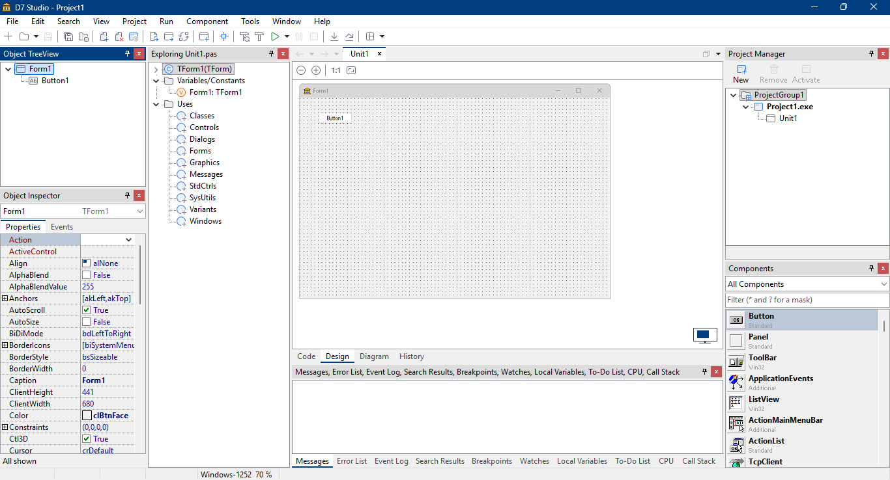

# D7 Studio

An IDE for Borland Delphi 7 projects, written in Delphi 7. It keeps the layout and the muscle
memory of the Delphi 7 IDE, with the look of the running Windows. Its setup also modernizes the
installed Delphi 7's RTL and VCL in place: native Unicode, per-monitor DPI awareness and the
current Windows API.

## Download

The setup is on the [Releases](https://github.com/iznoguuud/d7studio/releases/latest) page:
`D7Studio-<version>-setup.exe`, with its SHA-256 in `D7Studio-<version>-setup.exe.sha256`.

It needs:
- an installed Delphi 7 with Update 1 (Delphi 7.1: Help | About shows "Version 7.0 (Build 8.1)");
  Setup checks every file it patches and changes nothing when one is not Update 1's;
- Windows 10 1903 or later, with the visual styles on;
- administrator rights.

A newer setup updates an installed D7 Studio in place and keeps its settings. Uninstalling D7
Studio gives Delphi 7 its own files back.

## What you get

- **The IDE**: one main window with docked, tabbed views; Delphi 7's form designer with
  Borland's design-time packages; the Object Inspector and Code Explorer in Delphi 7's layout; a
  Scintilla code editor with code insight, names coloured by kind, Error Insight and a source
  formatter; the debugger; light and dark themes. It loads Delphi 7's experts and design packages.
- **Two experts of its own**: an AI assistant and Git, as docked views of the IDE.
- **The modernized RTL/VCL**: programs built with it can run with UTF-8 as their code page, scale
  per monitor (per-monitor DPI awareness V2), use the current file and folder dialogs, task
  dialogs and Windows' current look, and call the Windows API up to Windows 11. It stays binary
  compatible with Delphi 7: existing DCUs, packages and Borland's design packages still link and
  load, and programs start on Windows XP unless they opt into the newer features.

## Documents

| Document | For |
|---|---|
| [source/README.md](source/README.md) | Installing D7 Studio, what Setup changes, the modernized RTL/VCL in your programs, the IDE |
| [source/FEATURES.md](source/FEATURES.md) | What D7 Studio's IDE has that Delphi 7's IDE does not, area by area |
| [source/RELEASE-NOTES.md](source/RELEASE-NOTES.md) | The release notes: what changed in each version - the IDE, its experts, the modernized RTL/VCL and Setup |
| [patch/MODERNIZATION.md](patch/MODERNIZATION.md) | The modernized RTL/VCL: its features and what a developer should know |
| [patch/README.md](patch/README.md) | How the patch is made: compiled from source, no decompilation, none of Borland's files in it |
| [source/THIRD-PARTY-NOTICES.md](source/THIRD-PARTY-NOTICES.md) | The icons: made from JetBrains' IntelliJ Platform icons (Apache License 2.0) - the licence, the notice and what was changed |
| [LICENSE.txt](LICENSE.txt) | D7 Studio's license (MIT), the licenses of the parts made by others, and Delphi 7 |

Setup installs the first four, the notices and the license into Delphi 7's `Bin`, where they link to each other.

## This repository

- `source\` - D7 Studio's sources: the IDE (`ide`, `editor`, `designer`, `codeinsight`,
  `debugger`), `migrate`, which carries an existing Delphi 7 configuration over, and the two
  experts (`experts\aiharness`, `experts\git`, with the code they share in `experts\kit`);
  `README.md`, `FEATURES.md` and `RELEASE-NOTES.md` (the release notes) with a copy of
  `patch\MODERNIZATION.md` beside them, as Setup installs the four into Delphi 7's `Bin`.
- `patch\` - the modernized RTL/VCL as Setup installs it: for each of Delphi 7 Update 1's files
  that it replaces, the difference from Borland's file (`Delta\`); the new units whole (`New\`);
  `manifest.txt` with every file's SHA-256; `patch.ps1`, which applies the patch to an installed
  Delphi 7 and takes it back.

The patch holds none of Borland's RTL/VCL files: the ones it changes exist here only as
differences, which need the copy of Delphi 7 that you own.

> [!IMPORTANT]
> **To build D7 Studio, patch your Delphi 7 first.** D7 Studio's sources use the modernized
> RTL/VCL (`ModernMan`, `Utf8Mode`, `WindowsEx` ...), which a stock Delphi 7 does not have, so they
> do not compile against it. Patch the Delphi 7 you build with by installing D7 Studio's setup, or
> with `patch\patch.ps1` from an elevated PowerShell (see
> [patch/MODERNIZATION.md](patch/MODERNIZATION.md)).

## License

D7 Studio's own work - the IDE, its experts and this project's changes to Delphi 7's RTL and
VCL - is released under the MIT License: [LICENSE.txt](LICENSE.txt). Parts made by others keep
their own licenses, which it lists. Delphi 7 is not part of D7 Studio: it needs your own licensed
copy.
